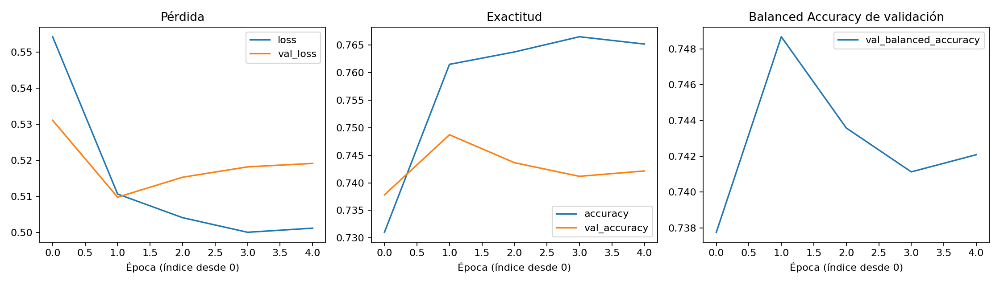

# Challenge 3: clasificación supervisada de imágenes histopatológicas
**Grupo 1 · Machine Learning · UPCH · 2026-II**

César Alejandro Aarón Apcho Meneses, Paola Andrea Centeno Bazán, Anderson Josué Delerna Infantes y Jimena Natalia Vega Sánchez.

**Docente:** Yannick Patrick Carrasco Merma.  
**Fecha de los envíos:** 15 de noviembre de 2026 (Lima).

## 1. Problema y competición
TNM112-Lab2 (2026) propone clasificar fragmentos histopatológicos de ganglios linfáticos según contengan tejido metastásico. La clase 0 representa ausencia y la clase 1 presencia de ese tejido. Utilizamos imágenes etiquetadas para entrenar una CNN y generar las clases de imágenes de prueba sin etiqueta [1].

El problema permite aplicar aprendizaje supervisado a imágenes y evaluar la capacidad de generalización con conjuntos separados. Los resultados describen un ejercicio académico de clasificación, sin atribuirle capacidad diagnóstica clínica.

## 2. Datos y preparación
PCam originalmente contiene fragmentos de 96 × 96 píxeles [2]. La competición utiliza un subconjunto recortado a **32 × 32 × 3** [1]. Comprobamos las claves, dimensiones, tipos de datos y distribución de clases de los HDF5 oficiales.

| Archivo | Ejemplos | Clase 0 | Clase 1 |
|---|---:|---:|---:|
| train.h5 | 100 000 | 49 964 | 50 036 |
| valid.h5 | 32 768 | 16 399 | 16 369 |
| test_x.h5 | 32 768 | Sin etiquetas | Sin etiquetas |

Entrenamiento y validación contienen las claves `x` e `y`; el test solo contiene `x`. Conservamos los píxeles en uint8 y dividimos entre 255 dentro del modelo. Mantuvimos las particiones oficiales sin mezclarlas. Las clases etiquetadas están casi equilibradas; la distribución del test es desconocida.

Los gráficos y las salidas están en el [notebook de análisis](../notebooks/01_analisis_dataset.ipynb).

## 3. Modelo y relación con la teoría
Es aprendizaje supervisado porque utilizamos ejemplos con una etiqueta conocida. La salida es binaria. Las redes neuronales aprenden pesos mediante retropropagación y optimización. Una CNN aplica filtros compartidos para aprender patrones locales de las imágenes y aprovechar su estructura espacial [3].

MLP, regresión logística, SVM y Random Forest son alternativas conceptuales. No las entrenamos en este trabajo. La competición solicita una CNN. Tampoco utilizamos pesos preentrenados, ResNet, EfficientNet, Focal Loss ni normalización de tinción.

La CNN seleccionada, **02_dropout**, tiene esta estructura:

| Etapa | Configuración |
|---|---|
| Entrada | RGB de 32 × 32 × 3; división entre 255 |
| Bloque 1 | Conv2D 16 filtros de 3 × 3, ReLU, MaxPooling |
| Bloque 2 | Conv2D 32 filtros de 3 × 3, ReLU, MaxPooling |
| Clasificación | GlobalAveragePooling, Dense 32 con ReLU, Dropout 0,3 |
| Salida | Dense 1 con sigmoide; clase 1 si probabilidad ≥ 0,5 |

Usamos Adam con tasa de aprendizaje 0,001 y entropía cruzada binaria. Esta configuración seleccionada no utiliza aumento de datos ni Batch Normalization.

## 4. Entrenamiento y experimentos
Entrenamos con las 100 000 imágenes oficiales y evaluamos en las 32 768 de validación. Mantuvimos batch size 256, semilla 42 y umbral 0,5. Después de cada época calculamos Balanced Accuracy, guardamos la mejor época y detuvimos el entrenamiento tras tres épocas sin mejora [4].

| Experimento | Cambio | Máximo de épocas | Épocas ejecutadas / mejor época |
|---|---|---:|---|
| 01_base | CNN con filtros 16/32 sin Dropout | 10 | 5 / 2 |
| 02_dropout | Añade Dropout de 0,3 | 12 | 5 / 2 |
| 03_aumento | Añade volteos y rotación aleatoria de 0,1 vueltas | 12 | 5 / 2 |
| 04_profunda | Filtros 32/64/128; mantiene aumento y Dropout | 15 | 4 / 1 |
| 05_batchnorm | Añade BatchNorm y cambia lr a 0,0005 | 15 | 7 / 4 |

La ejecución original en Kaggle terminó en **39 min 23 s**, con CPU, Python 3.13.18 y TensorFlow 2.21.0. Las ocho celdas del notebook 02 conservan sus salidas. Seleccionamos el modelo usando validación antes de consultar los puntajes públicos.

## 5. Métricas y resultados
La métrica oficial es **Balanced Accuracy**, el promedio del recall de las dos clases [1, 5]. En clasificación binaria:

**Balanced Accuracy = (sensibilidad + especificidad) / 2**

Aunque los datos etiquetados están equilibrados, esta métrica da el mismo peso a cada clase. Accuracy, precision, recall, F1 y ROC-AUC complementan el análisis.

| Experimento | BA validación | Accuracy | F1 | ROC-AUC | BA pública Kaggle |
|---|---:|---:|---:|---:|---:|
| 01_base | 0.748465 | 0.748474 | 0.745853 | 0.828812 | 0.73509 |
| 02_dropout | 0.748689 | 0.748718 | 0.740236 | 0.831596 | 0.73680 |
| 03_aumento | 0.708144 | 0.708282 | 0.656163 | 0.788403 | 0.67441 |
| 04_profunda | 0.698728 | 0.698853 | 0.651036 | 0.785630 | 0.67547 |
| 05_batchnorm | 0.689939 | 0.690186 | 0.575869 | 0.863333 | 0.65238 |

La mayor Balanced Accuracy de validación fue **0,7486889938079699**, con Dropout. La diferencia respecto a la base fue aproximadamente **0,000224**, o **0,0224 puntos porcentuales**. Es pequeña y solo contamos con una ejecución por configuración, por lo que no demuestra una mejora estable.

El aumento de datos y la mayor profundidad no mejoraron el resultado en esta prueba. Esto no permite concluir que esas técnicas sean inferiores en general.

La segunda época fue la mejor para Dropout. El entrenamiento terminó después de cinco épocas por la parada temprana.

| Clase real | Predicción 0 | Predicción 1 |
|---|---:|---:|
| 0 | 12 802 | 3 597 |
| 1 | 4 637 | 11 732 |

La sensibilidad fue **0,716721** y la especificidad **0,780657**. El modelo dejó sin identificar 4 637 ejemplos positivos en validación. Estos errores deben considerarse al interpretar sus límites.

## 6. Cinco envíos reales a Kaggle
Los cinco archivos terminaron con estado **Complete**, con puntuaciones públicas superiores a 0,5. Por ello cumplen el requisito de al menos cinco envíos mejores que una predicción aleatoria indicado por el organizador [1].

| Experimento | BA pública | Estado | Seleccionado final |
|---|---:|---|---|
| 01_base | 0.73509 | Complete | Sí |
| 02_dropout | 0.73680 | Complete | Sí |
| 03_aumento | 0.67441 | Complete |  |
| 04_profunda | 0.67547 | Complete |  |
| 05_batchnorm | 0.65238 | Complete |  |

La cuenta delegada fue **cesarapcho**. Los cuatro autores figuran en el notebook y en las descripciones de los envíos. Dropout y la base quedaron seleccionados para la evaluación final. La puntuación privada depende de la publicación del organizador.

El ejemplo de Evaluation mostraba `ID,Class` desde 1. Dos intentos de Dropout fueron rechazados: primero por el nombre de la columna, y después por el rango de identificadores. El evaluador aceptó **`id,Class`**, con ID de **0 a 32767** en el orden original de `test_x.h5`.

La corrección solo cambia encabezado y base del índice. Conservamos todas las clases predichas. Los SHA-256 en [envios_kaggle.csv](../results/cnn/envios_kaggle.csv) identifican exactamente los cinco archivos enviados.

## 7. Reproducción y participación
El [notebook 01](../notebooks/01_analisis_dataset.ipynb) documenta el análisis. El [notebook 02](../notebooks/02_entrenamiento_cnn.ipynb) conserva el entrenamiento. El [notebook 03](../notebooks/03_preparacion_envios.ipynb) reproduce la exportación final.

Para generar los CSV sin entrenar, clonar el repositorio y ejecutar `python scripts/preparar_envios.py` desde su raíz. Solo requiere Python estándar. Genera cinco `submission_*.csv` y copia el de Dropout como `submission.csv`. No realiza envíos automáticos.

Para repetir el entrenamiento se necesitan los tres HDF5 oficiales y las dependencias de `requirements-cnn.txt`. Las instrucciones en Colab, Kaggle y Jupyter están en [notebooks/README.md](../notebooks/README.md). Los modelos permanecen en los outputs privados de Kaggle. Cambiar de entorno puede producir variaciones en los resultados.

Según la indicación recibida del docente, una cuenta realiza la entrega y reconoce a los cuatro autores. No atribuimos funciones individuales adicionales que el grupo no haya confirmado.

## 8. Conclusiones
Las cinco CNN obtuvieron puntajes públicos superiores a la referencia aleatoria. Dropout fue la configuración elegida con validación y obtuvo también la mayor puntuación pública, **0,73680**. Las técnicas adicionales no produjeron mejoras en esta ejecución.

La validación y el leaderboard evalúan conjuntos distintos. El puntaje público no sustituye el resultado privado ni demuestra utilidad clínica. Para estudiar la estabilidad del resultado harían falta repeticiones con varias semillas.

## Referencias
[1] Kaggle. TNM112-Lab2 (2026). [Descripción, datos y evaluación](https://www.kaggle.com/competitions/tnm-112-lab-2-2026).

[2] B. S. Veeling, J. Linmans, J. Winkens, T. Cohen y M. Welling. “Rotation Equivariant CNNs for Digital Pathology”, 2018. [arXiv:1806.03962](https://arxiv.org/abs/1806.03962).

[3] TensorFlow. [Image classification](https://www.tensorflow.org/tutorials/images/classification).

[4] Keras. [ModelCheckpoint](https://keras.io/api/callbacks/model_checkpoint/).

[5] Scikit-learn. [balanced_accuracy_score](https://scikit-learn.org/stable/modules/generated/sklearn.metrics.balanced_accuracy_score.html).
