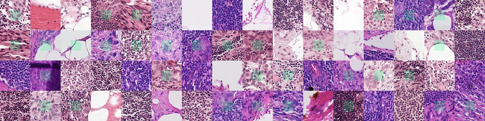
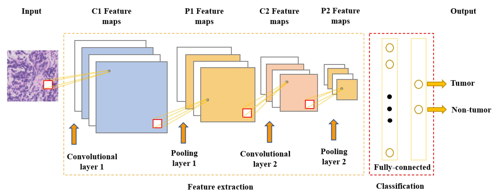

<div align="center">


### Clasificación de imágenes histopatológicas mediante aprendizaje supervisado

Proyecto académico · Universidad Peruana Cayetano Heredia · 2026-II

   

[**Ver competición en Kaggle**](https://www.kaggle.com/competitions/tnm-112-lab-2-2026) · [**Consultar dataset PCam**](https://patchcamelyon.grand-challenge.org/)

</div>

<p align="center">
  
</p>

## Explora el proyecto

El **Grupo 1** participa en el reto **TNM112-Lab2 (2026)** de Kaggle: identificar tejido metastásico en fragmentos de imágenes histopatológicas mediante una red neuronal convolucional (CNN).

<table>
<tr>
<td width="50%" valign="top" align="center">

**01 · CONTEXTO DEL RETO**

Comprende la problemática médica, el objetivo y la razón de elegir esta competición.

<a href="#1-introducción">Introducción</a> · <a href="#22-problemática">Problemática</a>

</td>
<td width="50%" valign="top" align="center">

**02 · COMPETICIÓN KAGGLE**

Consulta el funcionamiento, las clases, la evaluación y las reglas de participación.

<a href="#24-funcionamiento-del-reto">Funcionamiento</a> · <a href="#25-evaluación-de-los-resultados">Evaluación</a>

</td>
</tr>
</table>

---

## 👥 Equipo de trabajo · Grupo 1

El presente proyecto es desarrollado por el **Grupo 1** del curso de Machine Learning de la **Universidad Peruana Cayetano Heredia (UPCH)**, correspondiente al semestre académico **2026-II**.

### Integrantes

| N.º | Apellidos y nombres |
|:---:|---|
| 1 | César Alejandro Aarón Apcho Meneses |
| 2 | Paola Andrea Centeno Bazán |
| 3 | Anderson Josué Delerna Infantes |
| 4 | Jimena Natalia Vega Sánchez |

**Docente:** Yannick Patrick Carrasco Merma  
**Curso:** Machine Learning  
**Universidad:** Universidad Peruana Cayetano Heredia  
**Semestre académico:** 2026-II

---

## 1. Introducción

El presente proyecto se desarrolla como parte del **Challenge 3 del curso Machine Learning** de la Universidad Peruana Cayetano Heredia (UPCH), correspondiente a la unidad de **Algoritmos de Aprendizaje Supervisado**.

Para este desafío se seleccionó la competición [TNM112-Lab2 (2026)](https://www.kaggle.com/competitions/tnm-112-lab-2-2026), disponible en Kaggle, que plantea la clasificación de imágenes histopatológicas mediante técnicas de aprendizaje supervisado.

El proyecto se enfoca en la identificación de tejido metastásico en fragmentos de imágenes microscópicas de ganglios linfáticos, utilizando el conjunto de datos **PatchCamelyon (PCam)**. La competición solicita entrenar una red neuronal convolucional (*Convolutional Neural Network*, CNN) para aprender patrones visuales y predecir la clase de imágenes que no se utilizaron durante el entrenamiento.

La participación permite aplicar conceptos de Machine Learning a un problema de análisis de imágenes médicas, comprender la evaluación de modelos supervisados y documentar los resultados obtenidos. Se trata de un ejercicio académico de clasificación de imágenes, **no de una herramienta validada para realizar diagnósticos clínicos**.

---

## 2. Descripción de la competición

### 2.1. Información general

| Característica | Descripción |
|---|---|
| **Nombre** | TNM112-Lab2 (2026) |
| **Plataforma** | Kaggle |
| **Organizador** | YifanD@LiU |
| **Área de aplicación** | Salud – Análisis de imágenes histopatológicas |
| **Tipo de aprendizaje** | Supervisado |
| **Tipo de problema** | Clasificación binaria |
| **Dataset** | PatchCamelyon (PCam) |
| **Modelo solicitado** | Red neuronal convolucional (CNN) |
| **Métrica de evaluación** | Balanced Accuracy |
| **Formato de entrega** | Archivo CSV con columnas `ID` y `Class` |
| **Competición** | [TNM112-Lab2 (2026)](https://www.kaggle.com/competitions/tnm-112-lab-2-2026) |

La información sobre las reglas, los envíos y la evaluación se obtuvo de la descripción de la competición publicada por su organizador [1].

### 2.2. Problemática

<div align="center">
  
  <p><em>Figura 1. Imagen ilustrativa de los fragmentos histopatológicos utilizados en el reto PCam. Fuente: recurso incluido en el repositorio; verificar y consignar la fuente original de la imagen.</em></p>
</div>

El cáncer de mama puede propagarse hacia los ganglios linfáticos. La presencia de células tumorales en estos tejidos es relevante para evaluar la extensión de la enfermedad y orientar decisiones médicas.

El estudio histopatológico permite observar muestras de tejido al microscopio. Sin embargo, revisar un gran volumen de imágenes y distinguir patrones asociados con tejido metastásico puede resultar una tarea exigente debido a la diversidad de estructuras microscópicas.

En este contexto, el aprendizaje supervisado permite entrenar modelos con imágenes previamente etiquetadas para reconocer patrones visuales y clasificar nuevos fragmentos. La competición **TNM112-Lab2 (2026)** plantea identificar si un fragmento histopatológico contiene o no tejido metastásico [1].

El conjunto **PCam** está compuesto por imágenes de **96 × 96 píxeles**. Según la definición del conjunto de datos original, la etiqueta positiva depende de la presencia de tejido tumoral en la **región central de 32 × 32 píxeles**, y no simplemente de su presencia en cualquier punto de la imagen [2, 4].

### 2.3. Objetivos del proyecto

**Objetivo general**

Desarrollar un modelo de clasificación supervisada basado en una red neuronal convolucional (CNN) que permita identificar la presencia o ausencia de tejido metastásico en fragmentos histopatológicos del conjunto de datos PatchCamelyon (PCam).

**Objetivos específicos**

1. Comprender la problemática de la clasificación de imágenes histopatológicas relacionada con la detección de metástasis.
2. Utilizar imágenes etiquetadas del dataset PCam para entrenar un modelo supervisado.
3. Implementar y evaluar una CNN para clasificar imágenes según la presencia o ausencia de tejido metastásico.
4. Analizar el rendimiento mediante la métrica **Balanced Accuracy**.
5. Generar predicciones sobre el conjunto de prueba y presentar los archivos correspondientes en Kaggle.

Estos objetivos describen el trabajo académico del grupo; el objetivo central de la competición es predecir correctamente las clases de las imágenes de prueba [1].

### 2.4. Funcionamiento del reto

<div align="center">
  
  <p><em>Figura 2. Esquema general del proceso propuesto de clasificación de imágenes histopatológicas mediante una CNN.</em></p>
</div>

La competición proporciona fragmentos de imágenes histopatológicas extraídos de escaneos digitales de ganglios linfáticos. Las imágenes de entrenamiento cuentan con etiquetas que indican la clase correspondiente, mientras que el conjunto de prueba requiere generar predicciones [1].

**Clases de clasificación**

| Clase | Categoría | Descripción |
|:---:|---|---|
| **0** | Negativa | No se identifica tejido metastásico en la región central de la imagen. |
| **1** | Positiva | Se identifica tejido metastásico en la región central de la imagen. |

El flujo general de resolución comprende:

1. **Obtención de datos:** acceder a los archivos de la competición en Kaggle.
2. **Preparación:** organizar y procesar las imágenes para que puedan ser utilizadas por el modelo.
3. **Entrenamiento:** utilizar las imágenes etiquetadas para entrenar una CNN.
4. **Predicción:** aplicar la CNN a las imágenes del conjunto de prueba.
5. **Envío y evaluación:** crear un archivo CSV con las predicciones y enviarlo a Kaggle para obtener la puntuación.

El archivo de entrega, denominado habitualmente `submission.csv`, debe incluir las columnas **`ID`** y **`Class`**. Este es un **ejemplo de formato**, no de predicciones reales del equipo:

```csv
ID,Class
1,0
2,1
3,0
```

### 2.5. Evaluación de los resultados

La competición utiliza **Balanced Accuracy**, una métrica que calcula el promedio de la sensibilidad (*recall*) obtenida en cada clase. A diferencia de la exactitud convencional (*Accuracy*), no se limita a calcular la proporción total de predicciones correctas [1, 3].

Para clasificación binaria, puede expresarse como:

$$
\text{Balanced Accuracy} = \frac{\text{Sensibilidad} + \text{Especificidad}}{2}
$$

Esta métrica es especialmente útil cuando existe un desequilibrio en la cantidad de muestras por clase, ya que considera el desempeño en ambas categorías. **No se asume que los datos de esta competición estén desbalanceados**: esto deberá comprobarse durante el análisis exploratorio.

La competición establece dos clasificaciones (*leaderboards*):

| Clasificación | Porcentaje del conjunto de prueba | Función |
|---|:---:|---|
| **Public Leaderboard** | 30 % | Permite consultar puntuaciones durante la competición. |
| **Private Leaderboard** | 70 % | Determina la posición final tras su publicación. |

Según las reglas del reto, la clasificación definitiva depende del **Private Leaderboard**. Una buena puntuación pública no garantiza el mismo resultado en la clasificación privada [1].

### 2.6. Requisitos de participación

De acuerdo con la descripción oficial de **TNM112-Lab2 (2026)**, se solicita [1]:

- Entrenar una **red neuronal convolucional (CNN)** para clasificar los fragmentos histopatológicos.
- Realizar al menos **cinco envíos válidos** (*submissions*) con resultados superiores a una predicción aleatoria, según el requisito de la competición.
- Explicar en el informe las modificaciones realizadas para mejorar la CNN.
- Enviar las predicciones en un **archivo CSV** con el formato establecido por Kaggle.

Además, se incentiva explorar técnicas como **aumento de datos (*data augmentation*)**, **regularización**, **aprendizaje por transferencia (*transfer learning*)** y **métodos de ensamble (*ensemble learning*)**. Estas técnicas son posibilidades de mejora y no deben presentarse como métodos ya implementados por el grupo.

### 2.7. Justificación de la elección

Se seleccionó **TNM112-Lab2 (2026)** por su relación con el aprendizaje supervisado estudiado en el curso y por su aplicación al análisis de imágenes médicas. A diferencia de problemas basados principalmente en variables tabulares, este reto propone aprender características visuales mediante redes neuronales convolucionales.

La identificación de tejido metastásico en ganglios linfáticos es un problema relevante en el estudio del cáncer de mama. Esto permite contextualizar el ejercicio de clasificación y comprender el potencial de las herramientas computacionales como apoyo al análisis de imágenes, sin confundir un resultado experimental con una validación clínica.

Además, la disponibilidad del conjunto PCam, el criterio de evaluación y la plataforma de envíos de Kaggle permiten documentar experimentos y comparar el desempeño de distintas configuraciones del modelo. Por estas razones, la competición representa una oportunidad para aplicar y evaluar los conocimientos desarrollados en la unidad de clasificación supervisada.

---

## Estructura del repositorio

| Ruta | Propósito |
|---|---|
| `README.md` | Documentación académica general del proyecto. |
| `data/` | Información y archivos pequeños relacionados con el dataset PCam. |
| `notebooks/` | Cuadernos de análisis, entrenamiento, evaluación y predicciones. |
| `images/` | Ejemplos de imágenes, diagramas y gráficos del proyecto. |
| `results/` | Métricas experimentales, evidencias y archivos de entrega a Kaggle. |

> Los datos de gran tamaño deben consultarse desde sus fuentes originales; no es necesario almacenarlos en GitHub.

---

## Referencias bibliográficas

[1] YifanD@LiU. (2026). *TNM112-Lab2 (2026)*. Kaggle. https://www.kaggle.com/competitions/tnm-112-lab-2-2026

[2] Veeling, B. S., Linmans, J., Winkens, J., Cohen, T., & Welling, M. (2018). *Rotation Equivariant CNNs for Digital Pathology*. arXiv. https://arxiv.org/abs/1806.03962

[3] Scikit-learn developers. (s. f.). *Balanced accuracy score*. Scikit-learn. https://scikit-learn.org/stable/modules/generated/sklearn.metrics.balanced_accuracy_score.html

[4] *PatchCamelyon benchmark*. (s. f.). Grand Challenge. https://patchcamelyon.grand-challenge.org/


---

<div align="center">

**Grupo 1 · Machine Learning · UPCH · 2026-II**

*Proyecto académico de clasificación supervisada de imágenes histopatológicas.*

</div>
