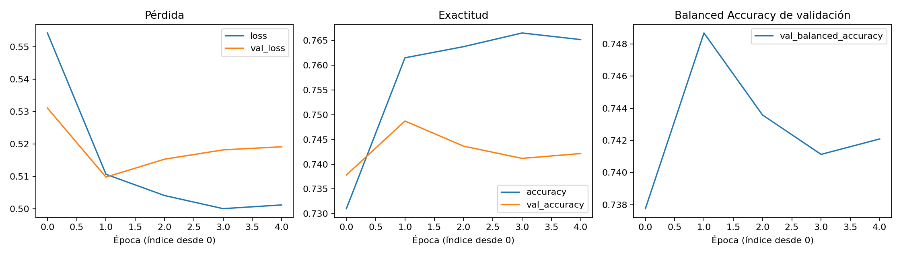
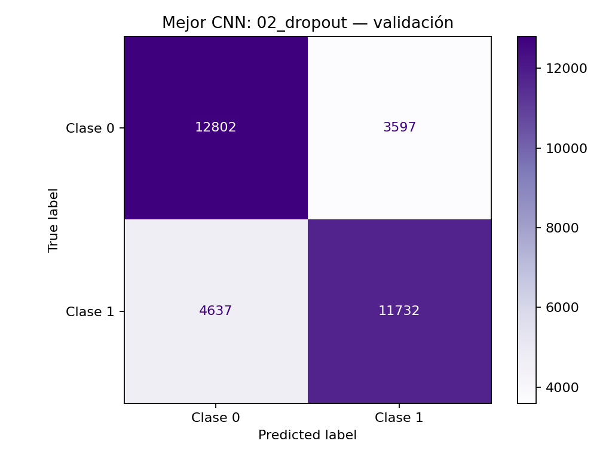

# Entrenamiento y evaluación de la CNN

Se ejecutó el [notebook 02](../../notebooks/02_entrenamiento_cnn.ipynb) con los tres HDF5 oficiales en Kaggle. La [versión original](https://www.kaggle.com/code/cesarapcho/challenge-3-upch-grupo-1-cnn-pcam?scriptVersionId=370083154) terminó correctamente en 39 min 23 s, el 15 de noviembre de 2026 (hora de Lima). Se utilizó CPU y TensorFlow 2.21.0. Los cuatro integrantes figuran como autores.

## Qué se hizo

Se utilizaron las 100 000 imágenes de entrenamiento y las 32 768 de validación de la competición. Las imágenes mantienen sus dimensiones de 32 × 32 × 3. La división de píxeles entre 255 forma parte del modelo. No se utilizaron pesos preentrenados ni etiquetas del conjunto de prueba.

Se compararon cinco configuraciones de CNN con semilla 42 y umbral 0,5. Se guardó la época con mayor Balanced Accuracy de validación y se aplicó parada temprana tras tres épocas sin mejora.

| Configuración | Cambio principal | Épocas ejecutadas | Mejor época | Balanced Accuracy | Accuracy | F1 | ROC-AUC |
|---|---|---:|---:|---:|---:|---:|---:|
| 01_base | CNN con filtros 16 y 32 | 5 | 2 | 0.748465 | 0.748474 | 0.745853 | 0.828812 |
| 02_dropout | Añade Dropout de 0,3 | 5 | 2 | **0.748689** | 0.748718 | 0.740236 | 0.831596 |
| 03_aumento | Añade volteos y rotaciones | 5 | 2 | 0.708144 | 0.708282 | 0.656163 | 0.788403 |
| 04_profunda | Tres bloques con filtros 32, 64 y 128 | 4 | 1 | 0.698728 | 0.698853 | 0.651036 | 0.785630 |
| 05_batchnorm | Añade Batch Normalization y cambia la tasa de aprendizaje | 7 | 4 | 0.689939 | 0.690186 | 0.575869 | 0.863333 |

Los valores completos están en [metricas_validacion.csv](metricas_validacion.csv). Son métricas de **validación**, no puntuaciones de Kaggle.

## Modelo seleccionado

La mayor Balanced Accuracy con umbral 0,5 fue **0,7486889938079699**, obtenida por **02_dropout**. Su arquitectura contiene dos bloques Conv2D/ReLU/MaxPooling con 16 y 32 filtros, Global Average Pooling, una capa densa de 32 neuronas, Dropout de 0,3 y una salida sigmoide. Utiliza Adam y entropía cruzada binaria.

La diferencia frente a la base fue de aproximadamente **0,000224**, equivalente a **0,0224 puntos porcentuales**. Es una diferencia pequeña: una única ejecución por configuración no demuestra una mejora estable. Las configuraciones con aumento de datos y más capas no superaron a la base en esta prueba.

El modelo entrenado y sus predicciones detalladas de validación se conservan en los outputs privados de la ejecución original de Kaggle. Esos archivos permiten recalcular sus métricas o reutilizar el modelo sin volver a entrenar.

## Curvas y matriz de confusión

| Clase real | Predicción 0 | Predicción 1 |
|---|---:|---:|
| 0 | 12 802 | 3 597 |
| 1 | 4 637 | 11 732 |

La sensibilidad de la clase positiva fue **0,716721**, mientras que la especificidad fue aproximadamente **0,780657**. Balanced Accuracy promedia ambos valores. Estas cifras describen la evaluación académica sobre los fragmentos de validación.

## Archivos generados para prueba

Cada candidato contiene **32 768 filas**, columnas **ID,Class** y etiquetas 0/1. El orden de las predicciones conserva el de `test_x.h5`.

- [Candidato del mejor modelo](candidato_mejor_modelo.csv).
- [Base](candidato_01_base.csv), [Dropout](candidato_02_dropout.csv), [aumento de datos](candidato_03_aumento.csv), [CNN profunda](candidato_04_profunda.csv) y [Batch Normalization](candidato_05_batchnorm.csv).

## Entrega confirmada en Kaggle

| Experimento | BA pública | Estado | Seleccionado final |
|---|---:|---|---|
| 01_base | 0.73509 | Complete | Sí |
| 02_dropout | 0.73680 | Complete | Sí |
| 03_aumento | 0.67441 | Complete |  |
| 04_profunda | 0.67547 | Complete |  |
| 05_batchnorm | 0.65238 | Complete |  |

El evaluador aceptó **id,Class**, con ID de **0 a 32767** en el orden original de `test_x.h5`. Los archivos `candidato_*` conservan el formato inicial. Para entregar usar [submission.csv](submission.csv) o las versiones `submission_*.csv`.

El [notebook 03](../../notebooks/03_preparacion_envios.ipynb) reproduce la corrección de encabezado e índice sin cambiar clases. Las firmas coinciden con las registradas antes de enviar los archivos. [Puntuaciones y SHA-256](envios_kaggle.csv).

Dropout y la base quedaron seleccionados para la evaluación final. La puntuación privada depende de la publicación del organizador. [Registro y guía](../../docs/ENTREGA_KAGGLE.md).

## Comprobaciones realizadas

- Las ocho celdas de código tienen contadores 1–8 y salidas guardadas, sin errores.
- Se recalcularon las Balanced Accuracy de los cinco experimentos a partir de sus predicciones de validación.
- Se comprobó la selección de la mejor época contra los historiales guardados.
- Se validaron los cinco CSV: cantidad de filas, encabezados, clases, ausencia de valores faltantes y unicidad de los ID provisionales.
- Se comprobaron sus firmas SHA-256 contra [archivos_generados.csv](archivos_generados.csv).
- El candidato seleccionado coincide con el de `02_dropout`.

Estas comprobaciones verifican los archivos producidos; se complementan con la aceptación y puntuación real de los cinco envíos.

## Cómo reproducirlo

Las instrucciones para Colab, Kaggle y Jupyter están en [notebooks/README.md](../../notebooks/README.md). El entorno y los experimentos utilizados están en [configuracion.json](configuracion.json); las firmas de los archivos oficiales permiten comprobar que se usan los mismos datos. [estado_ejecucion.json](estado_ejecucion.json) registra la finalización y las métricas seleccionadas.

En GitHub se conservan los historiales y métricas de las cinco configuraciones, los candidatos y las figuras. Los artefactos completos de las cinco configuraciones permanecen en los outputs de la ejecución original de Kaggle. Las diferencias de entorno pueden producir variaciones al repetir el entrenamiento.

La [guía de entrega](../../docs/ENTREGA_KAGGLE.md) recoge la participación de los cuatro integrantes y los pasos pendientes para la competición y la presentación del curso.
