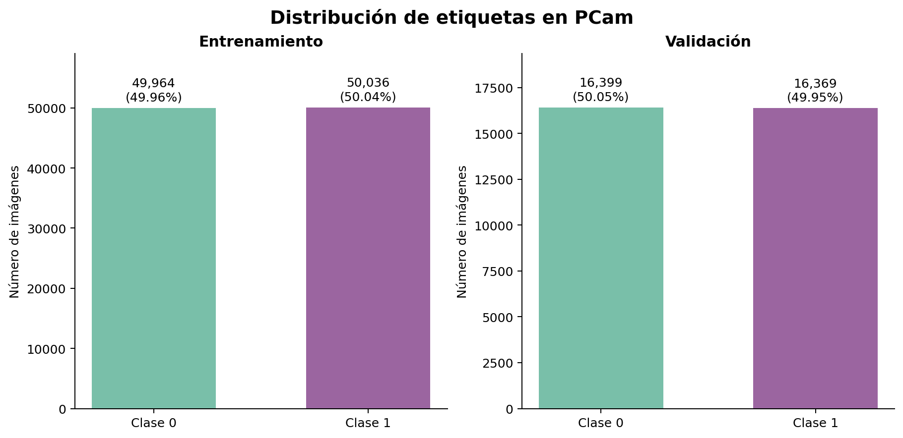
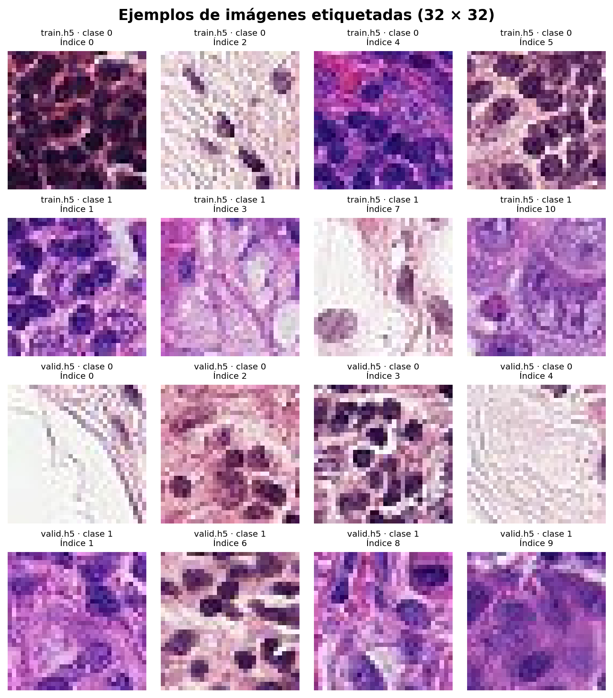

# Análisis exploratorio del dataset

Se revisaron los tres archivos de [TNM112-Lab2 (2026)](https://www.kaggle.com/competitions/tnm-112-lab-2-2026) el 11 de noviembre de 2026. El análisis comprendió la estructura de los archivos, los valores de los píxeles y las etiquetas disponibles. No se entrenó ningún modelo en esta etapa.

## Estructura de los datos

| Archivo | Claves | Dimensiones de `x` | Dimensiones de `y` | Tipo | Rango de píxeles | Media de píxeles |
|---|---|---|---|---|---|---:|
| `train.h5` | `x`, `y` | 100 000 × 32 × 32 × 3 | 100 000 | `uint8` | 0–255 | 163,740 |
| `valid.h5` | `x`, `y` | 32 768 × 32 × 32 × 3 | 32 768 | `uint8` | 0–255 | 163,096 |
| `test_x.h5` | `x` | 32 768 × 32 × 32 × 3 | No contiene `y` | `uint8` | 0–255 | 160,398 |

La media considera todos los valores de píxeles y canales de cada archivo. El conjunto de prueba no contiene etiquetas ni identificadores; queda por comprobar cómo se asignan los `ID` solicitados para la submission.

## Distribución de las etiquetas

| Conjunto | Clase 0 | Clase 1 | Total |
|---|---:|---:|---:|
| Entrenamiento | 49 964 (49,964 %) | 50 036 (50,036 %) | 100 000 |
| Validación | 16 399 (50,046 %) | 16 369 (49,954 %) | 32 768 |

Las dos clases tienen cantidades muy similares en entrenamiento y validación. No es posible calcular esta distribución para prueba, porque sus etiquetas no están disponibles. La competición emplea *balanced accuracy*, una métrica que promedia el recall de las clases.



## Ejemplos de imágenes



Se muestran los primeros cuatro ejemplos de cada clase encontrados en entrenamiento y validación. Estas imágenes permiten observar el formato del dataset, pero no representan toda su variabilidad. Las clases corresponden a las etiquetas originales; no son diagnósticos realizados por el equipo.

## Carga y preparación

Los archivos `.h5` pueden leerse con `h5py`. En el siguiente ejemplo, `x` corresponde a las imágenes de entrenamiento y `y`, a sus etiquetas:

```python
import h5py

with h5py.File("data/train.h5", "r") as archivo:
    imagenes = archivo["x"][:]
    etiquetas = archivo["y"][:]

print(imagenes.shape, etiquetas.shape)
```

Como preparación para una CNN, se puede convertir cada lote a valores decimales y dividirlo entre 255. Debe aplicarse la misma transformación a entrenamiento, validación y prueba. Cualquier parámetro que se aprenda durante el preprocesamiento debe calcularse únicamente con entrenamiento.

## Reproducir el análisis

El [cuaderno de análisis](../../notebooks/01_analisis_dataset.ipynb) contiene el código y las salidas guardadas. Las instrucciones para ejecutarlo en Google Colab y Jupyter están en la [guía de cuadernos](../../notebooks/README.md).

También se dispone de un [script de análisis](../../scripts/analisis_dataset.py) que genera las tablas CSV y las dos figuras de esta carpeta. Para ejecutarlo desde la raíz del repositorio, con los `.h5` dentro de `data/`:

```bash
python -m pip install -r requirements-eda.txt
python scripts/analisis_dataset.py --datos data --salida results/eda
```

Las tablas y figuras se volverán a escribir en `results/eda/`.

## Fuentes

- [Datos de la competición](https://www.kaggle.com/competitions/tnm-112-lab-2-2026/data).
- [PatchCamelyon benchmark](https://patchcamelyon.grand-challenge.org/).
- B. S. Veeling et al., [Rotation Equivariant CNNs for Digital Pathology](https://arxiv.org/abs/1806.03962), 2018.
